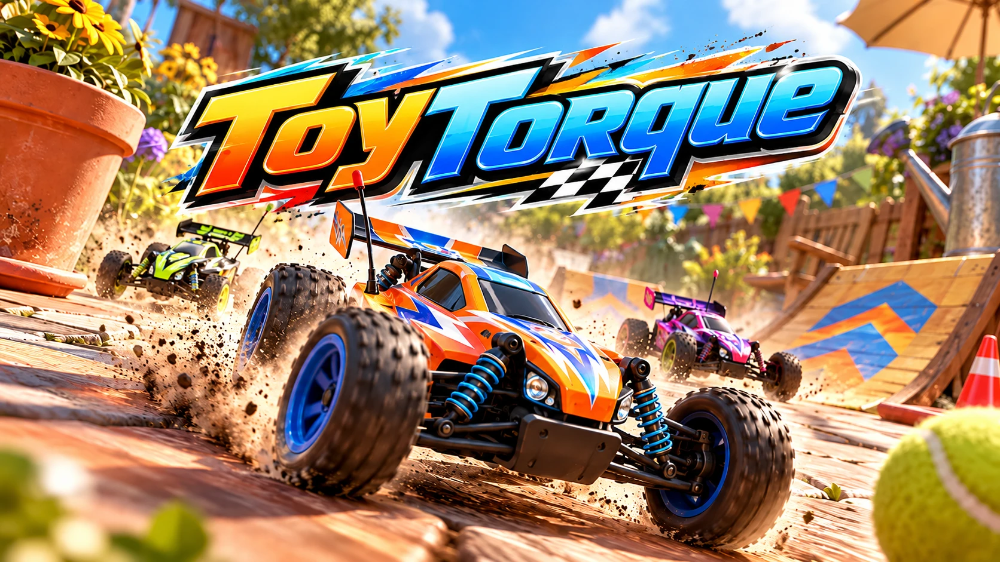

# ToyTorque



ToyTorque är ett racingspel med radiostyrda leksaksbilar som tävlar i köket, i trädgården, på ett museum, i en leksaksaffär och på däcket på en kryssare. Spelet körs direkt i webbläsaren och finns även som Mac-app.

*An arcade racing game with radio-controlled toy cars, built with three.js and the Rapier physics engine. Runs in the browser and as a macOS app. The game and the code comments are in Swedish.*

**Spela i webbläsaren:** <https://www.criteroconsulting.se/spel/toytorque/>

**Mac-app:** [ladda ner ToyTorque för Mac](https://github.com/Criterio-inc/toytorque/releases/latest). Appen är signerad och notariserad av Apple och fungerar på både Intel och Apple Silicon. Öppna DMG-filen och dra ToyTorque till Program.

## Det här finns i spelet

Spelet har 21 bilar i fem klasser och nio banor med hopp, broar och genvägar. Du kan köra enkla lopp, mästerskap i fyra cuper, tidskörning mot din egen spökbil och stuntarenan med 20 stjärnor att jaga. Två spelare kan köra på delad skärm, och med banbyggaren gör du egna banor.

Det finns elva vapen, bland annat fyrverkerier, elchock, olja och bomb. Allt är byggt i kod: bilarna, banorna, musiken och ljudeffekterna. Spelet använder inga färdiga modeller, bilder eller ljudfiler.

## Styrning

| Tangent | Gör |
|---|---|
| W / S | gas, broms och back |
| A / D | styr |
| Mellanslag eller E | avfyra vapen |
| F | tillbaka på vägen |
| R | tillbaka till senaste punkten |
| C | byt kamera |
| Esc | paus |

Handkontroll fungerar också. Spelare 2 kör med piltangenterna.

## Kom igång

Du behöver Node.js 20 eller senare.

```bash
npm install
npm run dev        # utvecklingsserver på http://localhost:5173
npm test           # körtester utan grafik: fysik, varv, AI, vapen
npm run build      # färdig webbversion i dist/
```

För att bygga Mac-appen behövs Rust och Tauri: `npm run app`. Den signerade och notariserade versionen byggs med `scripts/release.sh` och kräver ett Developer ID-certifikat från Apple.

## Licens

Koden och grafiken är fria under [MIT-licensen](LICENSE). Spelet använder three.js (MIT) och Rapier (Apache 2.0); licenstexterna finns i [THIRD_PARTY_LICENSES.txt](THIRD_PARTY_LICENSES.txt).

ToyTorque är ett eget spel som är inspirerat av klassiska racingspel med radiostyrda bilar. Det har ingen koppling till något annat spel eller varumärke.

Skapat av Pär Levander, [Critero Consulting](https://www.criteroconsulting.se).
